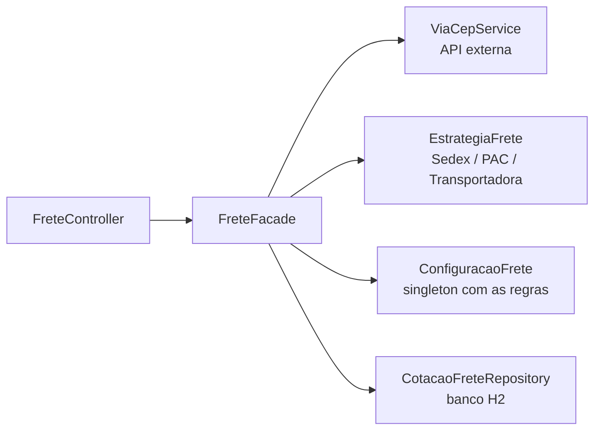

<div align="center">

# Frete API

[](https://adoptium.net)
[](https://spring.io/projects/spring-boot)
[](https://maven.apache.org/wrapper/)

API REST de cotação de frete que demonstra os padrões **Singleton**, **Strategy** e **Facade** com Spring Boot.

[Visão geral](#visão-geral) • [Como rodar](#como-rodar) • [Padrões aplicados](#padrões-aplicados) • [Endpoints](#endpoints) • [Estrutura](#estrutura)

</div>

## Visão geral

Projeto desenvolvido como desafio final do módulo de **Padrões de Projeto (Design Patterns)**.

O usuário informa o CEP de destino, o peso e o tipo de entrega. A API consulta o endereço no [ViaCEP](https://viacep.com.br), calcula valor e prazo com a estratégia escolhida, aplica a taxa interestadual quando o destino está fora da UF de origem e salva a cotação no histórico.



**Tecnologias:** Java 17, Spring Boot 3 (Web, Data JPA, Validation), H2 em memória, `RestClient`, SpringDoc OpenAPI (Swagger UI), JUnit 5, Mockito e AssertJ.

## Como rodar

### Pré-requisitos

- [Java 17+](https://adoptium.net)

Não é preciso instalar o Maven: o projeto inclui o Maven Wrapper (`mvnw`).

> [!IMPORTANT]
> As cotações consultam o ViaCEP em tempo real, então a aplicação precisa de acesso à internet. Se o serviço estiver fora do ar, a API responde `502 Bad Gateway`.

### Iniciar a aplicação

```bash
./mvnw spring-boot:run
```

> [!TIP]
> No Windows, use `mvnw.cmd` no lugar de `./mvnw`.

Com a aplicação no ar:

| Recurso | Endereço |
|---|---|
| Swagger UI | http://localhost:8080/swagger-ui.html |
| Console do H2 | http://localhost:8080/h2-console (JDBC URL `jdbc:h2:mem:fretedb`, usuário `sa`, sem senha) |

### Rodar os testes

```bash
./mvnw test
```

### Configuração

As regras globais ficam em `src/main/resources/application.properties`:

| Propriedade | Padrão | Descrição |
|---|---|---|
| `frete.origem-uf` | `SP` | UF de onde as encomendas saem |
| `frete.taxa-interestadual` | `1.30` | Multiplicador aplicado quando o destino é de outra UF (+30%) |

## Padrões aplicados

### Singleton: `ConfiguracaoFrete`

No Spring, todo bean (`@Component`, `@Service`...) é **singleton por padrão**: o contêiner cria uma única instância e a compartilha com toda a aplicação. `ConfiguracaoFrete` guarda as regras globais lidas do `application.properties` e é a mesma instância em todos os lugares que a usam.

Diferente do Singleton clássico em Java puro, não há construtor privado nem `getInstancia()`, pois o Spring cuida do ciclo de vida. Como a instância é compartilhada entre requisições, ela é **imutável** (campos `final`).

### Strategy: `EstrategiaFrete`

Cada forma de calcular o frete é uma estratégia que implementa a mesma interface:

| Estratégia | Tipo (`tipoFrete`) | Valor | Prazo (mesma UF / outra UF) |
|---|---|---|---|
| `FreteSedex` | `sedex` | R$ 15 + R$ 8/kg | 1 / 3 dias |
| `FretePac` | `pac` | R$ 10 + R$ 4/kg | 5 / 9 dias |
| `FreteTransportadora` | `transportadora` | R$ 30 + R$ 2,50/kg (mínimo de 5 kg) | 4 / 7 dias |

O Spring injeta todas as estratégias num `Map<String, EstrategiaFrete>`, cuja chave é o nome do bean. A escolha acontece em tempo de execução, sem `if/else`:

```java
EstrategiaFrete estrategia = estrategias.get(request.tipoFrete());
BigDecimal valor = estrategia.calcularValor(request.pesoKg());
```

> [!NOTE]
> Para adicionar um novo tipo de frete basta criar uma classe. Nada mais no projeto precisa mudar, e o novo tipo já aparece em `GET /fretes/tipos` e na comparação.
>
> ```java
> @Component("motoboy")
> public class FreteMotoboy implements EstrategiaFrete {
>     public BigDecimal calcularValor(double pesoKg) { return new BigDecimal("12.00"); }
>     public int calcularPrazoDias(boolean interestadual) { return 0; }
>     public String descricao() { return "Entrega no mesmo dia"; }
> }
> ```

### Facade: `FreteFacade`

Uma cotação envolve vários passos: validar o CEP e o peso, consultar o ViaCEP, escolher a estratégia, aplicar a taxa interestadual e salvar no banco. A `FreteFacade` esconde essa orquestração atrás de métodos simples, e o controller fica com uma linha por endpoint:

```java
@PostMapping
public CotacaoResponse cotar(@RequestBody @Valid CotacaoRequest request) {
    return freteFacade.cotar(request);
}
```

## Endpoints

| Método | Rota | Descrição |
|---|---|---|
| `POST` | `/fretes` | Cota um frete e salva no histórico (`201 Created`) |
| `GET` | `/fretes/comparar?cep=&pesoKg=` | Simula todos os tipos, do mais barato ao mais caro |
| `GET` | `/fretes` | Histórico de cotações, das mais recentes para as mais antigas |
| `GET` | `/fretes/tipos` | Tipos de frete disponíveis |

O CEP aceita os formatos `01001-000` e `01001000`, e o peso deve ser maior que 0 e no máximo 100 kg.

### Cotar um frete

```bash
curl -X POST http://localhost:8080/fretes \
  -H "Content-Type: application/json" \
  -d '{"cep": "20040-020", "pesoKg": 2, "tipoFrete": "sedex"}'
```

```json
{
  "id": 1,
  "tipoFrete": "sedex",
  "cep": "20040020",
  "cidade": "Rio de Janeiro",
  "uf": "RJ",
  "pesoKg": 2.0,
  "valor": 40.30,
  "prazoDias": 3,
  "criadaEm": "2026-10-29T14:32:10"
}
```

Como a origem é SP e o destino é RJ, a taxa interestadual de 30% foi aplicada (R$ 31,00 → R$ 40,30).

### Comparar todas as opções

```bash
curl "http://localhost:8080/fretes/comparar?cep=01001000&pesoKg=20"
```

Com 20 kg, a transportadora (R$ 80,00) sai mais barata que o PAC (R$ 90,00) e bem mais barata que o Sedex (R$ 175,00), o que mostra na prática por que cada estratégia existe.

### Erros

Os erros seguem o padrão **Problem Details ([RFC 7807](https://www.rfc-editor.org/rfc/rfc7807))**:

| Situação | Status |
|---|---|
| Campos inválidos, CEP mal formatado, peso fora do limite ou tipo de frete inexistente | `400` |
| CEP não encontrado no ViaCEP | `404` |
| ViaCEP indisponível | `502` |

## Estrutura

```
src/main/java/br/com/freteapi
├── config/        ConfiguracaoFrete (Singleton)
├── strategy/      EstrategiaFrete e implementações (Strategy)
├── facade/        FreteFacade (Facade)
├── controller/    endpoints REST
├── service/       integração com o ViaCEP
├── repository/    acesso ao banco
├── model/         entidade e endereço
├── dto/           objetos de entrada e saída
└── exception/     exceções e tratamento global de erros
```
